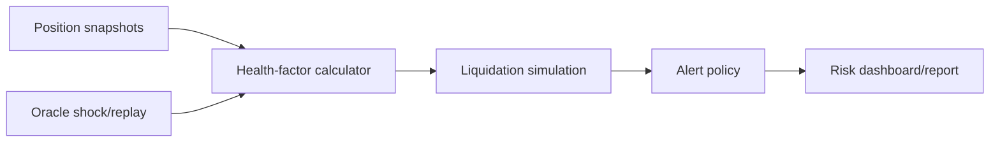

# Aave Liquidation & Oracle Risk Monitoring Engine

A deterministic risk engine for reconstructing lending positions, applying collateral price shocks, and estimating liquidation exposure, keeper repayment, seized collateral, gas, and residual bad debt.

## Architecture


## Structural overview
`src/aave_risk/engine.py` contains health-factor math, shock replay, liquidation estimates, and alert severity; `cli.py` demonstrates the replay; `tests/` covers healthy and stressed positions.

## Workflow
1. Load normalized collateral and debt positions.
2. Compute health factor from collateral value and liquidation threshold.
3. Replay oracle shocks and gas assumptions.
4. Estimate partial repayment, seized collateral, and bad debt.
5. Emit severity alerts for monitoring.

## Why this approach
The engine separates protocol accounting from alert policy. This makes it possible to replace the shock model or thresholds without changing the position reconstruction layer.

## Run
```bash
pip install -e .
python -m aave_risk.cli
pytest -q
```

## Limitations
The current model abstracts reserve configuration, close-factor changes, oracle heartbeat timing, and multi-asset correlation. Validate against historical Aave events before using it for operational decisions.
