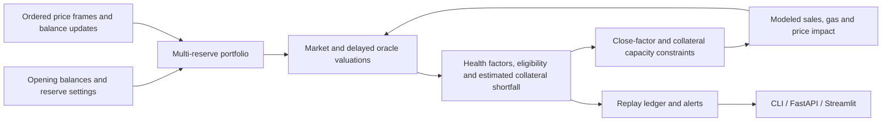
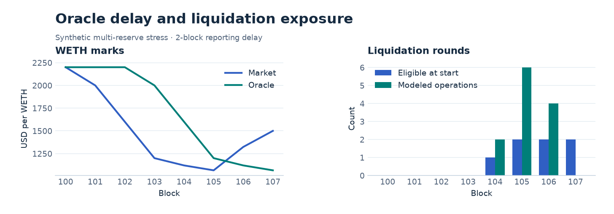

# Aave Liquidation & Oracle Risk Monitoring Engine

Replay multi-reserve lending portfolios through price shocks, delayed oracle marks and liquidation rounds. The same risk engine serves the CLI, FastAPI service and Streamlit dashboard.

## Run a replay

Requires Python 3.11 or later.

```bash
python -m pip install -e '.[dashboard,test]'
aave_liquidation_risk_engine --write-scenario reports/scenario.json --output reports/risk.json
aave_liquidation_risk_engine --input reports/scenario.json --oracle-delay-blocks 0 \
  --output reports/risk-immediate.json
python -m pytest -q
```

Run the application with Compose and open the dashboard at `http://127.0.0.1:8501`. API documentation is at `http://127.0.0.1:8000/docs`.

```bash
docker compose up --build
```

For a local Python-only launch, run each command in its own terminal. Set `AAVE_RISK_API=http://127.0.0.1:8000` for the dashboard process to use the service.

```bash
uvicorn aave_risk.api:app
streamlit run src/aave_risk/dashboard.py
```

## Architecture



| Component | Responsibility |
|---|---|
| `scenario.py` | Validates reserve settings, explicit balance snapshots, full price vectors and monotonic block order. |
| `stress.py` | Values portfolios, applies a lagged oracle and evaluates bounded rounds of liquidation feedback. |
| `account_data.py` | Queries aggregate Aave account data through a canonical, block-hash-pinned call. |
| `api.py` and `dashboard.py` | Expose replay requests, block-level charts, positions, alert summaries and downloadable reports. |

## Scenario contract and model

- `reserves` declare asset keys, liquidation thresholds, liquidation bonuses and modeled market depth in USD.
- `initial_balances` supply collateral and debt token units for account–asset pairs. A frame can replace those quantities with `balance_updates`.
- `frames` carry increasing block numbers, a complete price vector and gas cost per modeled operation. Oracle observations come from the latest available simulated market mark at or before the delayed block, with the initial observation used at startup.
- `config` sets the oracle delay, close factor, impact cap, maximum rounds and watch threshold. Set `simulate_liquidations` to `false` to observe exposure without changing balances.
- Health factor is the sum of threshold-weighted collateral values divided by debt value. A debt-free portfolio has a null health factor. The report distinguishes oracle eligibility, market distress during an oracle gap and a watch threshold. [Aave health factor](https://aave.com/docs/aave-v3/markets/health-factor)
- In each modeled round, repayment is bounded by the close factor and collateral capacity after bonuses. Reserve sales move marks in proportion to depth within the round cap. The report records cumulative modeled gas, market-valued shortfall and the before/after eligibility counts.

## API and account snapshots

```bash
curl -s http://127.0.0.1:8000/v1/demo
curl --fail -H 'Content-Type: application/json' \
  --data-binary @reports/scenario.json http://127.0.0.1:8000/v1/replay
```

The read-only account command validates the chain ID and uses the selected block hash. Set `RPC_URL` to a provider that retains the chosen historical state and supports canonical block-hash references. Substitute the Pool proxy address and price-feed base decimals for the deployment. The Ethereum example below was verified at block 26,487,246, subject to the provider's retention window.

```bash
export RPC_URL=https://ethereum-rpc.publicnode.com
aave_liquidation_risk_engine --chain-id 1 --block 26487246 \
  --pool 0x87870bca3f3fd6335c3f4ce8392d69350b4fa4e2 \
  --account 0x0000000000000000000000000000000000000001
```

The query returns aggregate collateral, debt, available borrow, thresholds and health factor. Scenario replay consumes reserve-level balances from a separate normalized dataset. [Aave V3 Pool interface](https://aave.com/docs/aave-v3/smart-contracts/pool)

## Reproduced demo results

The synthetic eight-block scenario has three accounts and three reserves. At the default two-block delay, the first modeled liquidation is at block 104. The replay's fixed close-factor, proportional collateral allocation and depth-impact rules are explicit scenario assumptions.



## Commit dates

Both Git date fields on the 40 commits in the November 2026 portfolio update
use retrospectively assigned milestones from 2026-08-01 through 2026-09-30,
the project period listed in the résumé. Each commit records its assigned date
in the Project-Milestone trailer and its original committer timestamp in
the Original-Commit-Date trailer. Use git log --format=fuller to inspect the dates.

## Compare oracle assumptions

Run `aave_liquidation_risk_engine --compare-lags 0 2 4 --output reports/lag-study.json`
or post a scenario and a unique list of integer `lags` to `/v1/compare`. Each
variant holds the balances, sampled market path, and risk policies fixed.

Set `max_oracle_age_blocks` to classify stale observations and
`pause_on_stale_oracle` to suspend modeled operations on stale marks. Bootstrap
observations are flagged separately. A severe close factor is an opt-in modeling
assumption and uses the configurable health threshold. The report distinguishes
opening distressed debt, cascade exposure, reserve composition, and market and
oracle shortfalls. The positions CSV uses one row per account and block.

Pinned account reads return exact base-unit amounts as strings alongside
display values. Scenario studies and account reads have separate input contracts.
